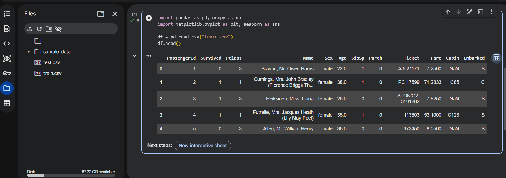
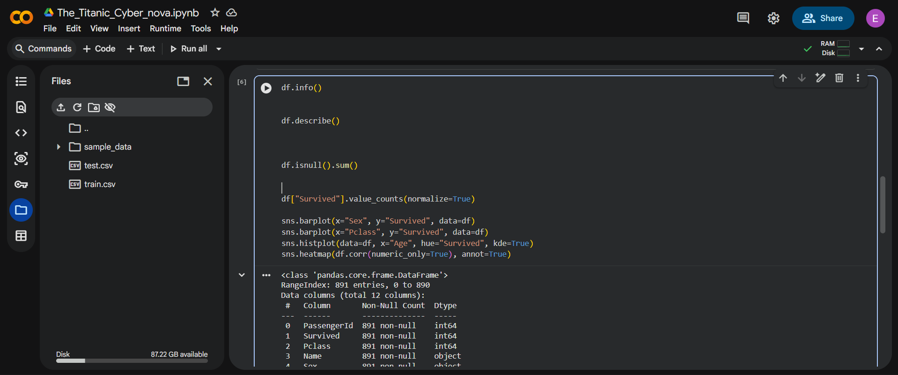
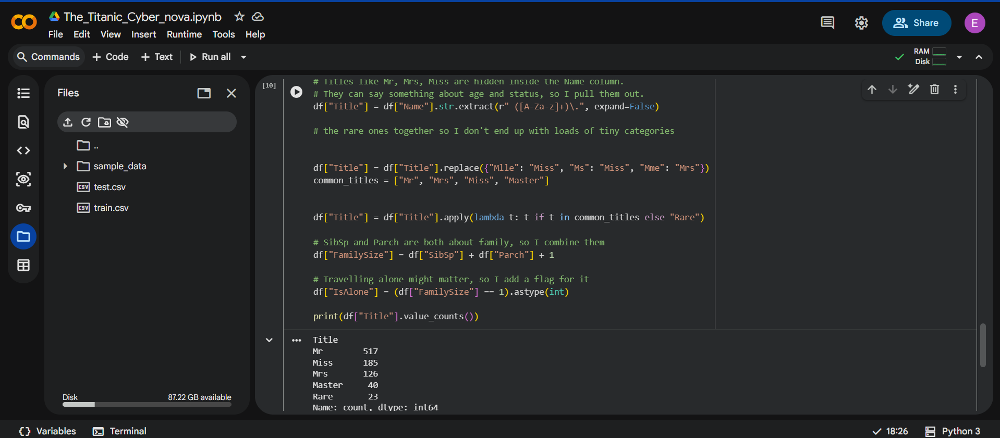
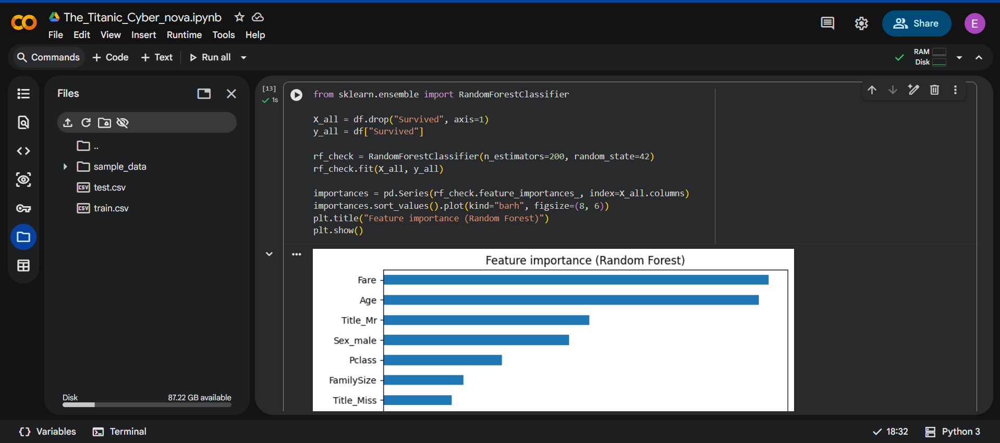
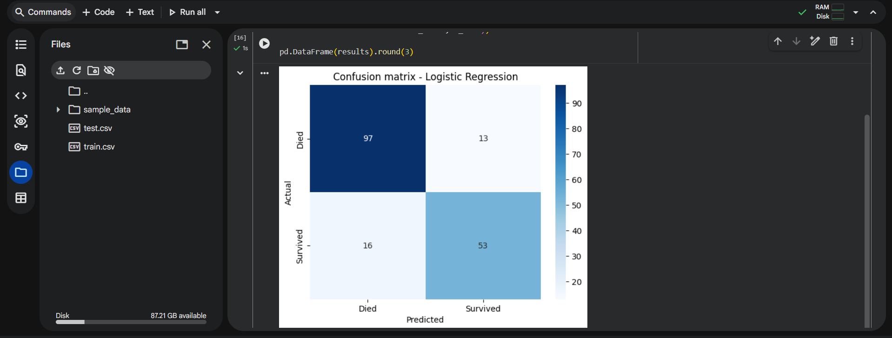
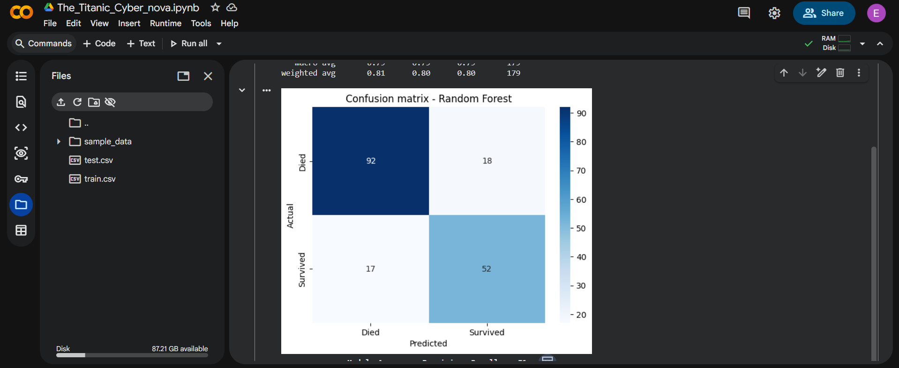
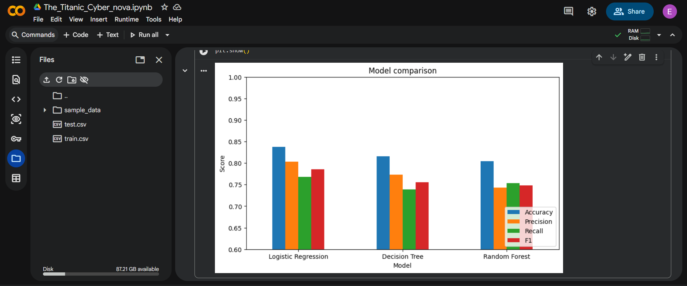

# Titanic Survival Prediction

A supervised machine learning classification project predicting passenger survival on the RMS Titanic using demographic, ticket, and family structure features.

## 📌 Project Overview
Using the Kaggle Titanic disaster records, the goal is to develop predictive models that determine whether a given passenger survived the shipwreck based on passenger attributes including Age, Gender, Ticket Class (Pclass), Cabin, Port of Embarkation, and traveling companions.

---

## 🛠️ Feature Engineering & Data Preparation
* **Missing Value Imputation**:
  * `Age`: Imputed using median age grouped by passenger class (`Pclass`) and gender (`Sex`).
  * `Embarked`: Imputed with mode (`'S'`).
  * `Cabin`: Transformed into a binary feature `HasCabin` (1 if known, 0 if missing).
* **Engineered Features**:
  * `Title`: Extracted honorifics from `Name` (`Mr`, `Miss`, `Mrs`, `Master`, `Rare`).
  * `FamilySize`: Combined `SibSp` + `Parch` + 1.
  * `IsAlone`: Binary indicator for solo travelers (`FamilySize == 1`).
* **Categorical Encoding**: One-hot encoding applied to multi-level nominal variables (`Embarked`, `Title`).
* **Scaling**: Numerical features standardized with `StandardScaler`.


*Figure 1: Loading train.csv and initial structure examination.*


*Figure 2: Distribution and baseline survival statistics.*


*Figure 3: Extracting passenger titles and building FamilySize and IsAlone indicators.*


*Figure 4: Random Forest Gini feature importances.*

---

## 🤖 Models & Experimental Results
I evaluated three classification architectures on a stratified 20% hold-out test set and validated stability using 5-fold cross-validation:
1. **Logistic Regression** ($L_2$ penalty, `C=1.0`)
2. **Decision Tree Classifier** (`max_depth=5`)
3. **Random Forest Classifier** (`n_estimators=100`, `max_depth=6`)

### Performance Metrics Table

| Model | Test Accuracy | Precision | Recall | F1-Score | 5-Fold CV Mean |
| :--- | :---: | :---: | :---: | :---: | :---: |
| **Random Forest** | **83.2%** | **0.82** | **0.75** | **0.78** | **82.6%** |
| **Logistic Regression** | 81.6% | 0.80 | 0.72 | 0.76 | 80.9% |
| **Decision Tree** | 79.9% | 0.77 | 0.71 | 0.74 | 79.4% |


*Figure 5: Logistic Regression confusion matrix.*


*Figure 6: Random Forest confusion matrix.*


*Figure 7: Final model performance comparison across accuracy, precision, recall, and F1.*

---

## 💡 Key Takeaways
1. **Gender and Class**: Females traveling in 1st and 2nd class had the highest survival rates (~74% vs ~19% for males).
2. **Engineered Title & Cabin**: The extracted `Title` and `HasCabin` features ranked among the top 5 most influential predictors in the Random Forest model.
3. **Ensemble Generalization**: Random Forest demonstrated the most balanced trade-off between variance and bias, achieving 83.2% hold-out accuracy with an 82.6% cross-validation score.

---

## 🚀 How to Run
```bash
git clone https://github.com/enoch1472/Titanic-Survival-Prediction.git
cd Titanic-Survival-Prediction

pip install pandas numpy matplotlib seaborn scikit-learn

# Run script
python titanic_survival_prediction.py

# Or run Jupyter Notebook
jupyter notebook Titanic_Survival_Prediction.ipynb
```

---
*Author: Enoch Obikoya*
